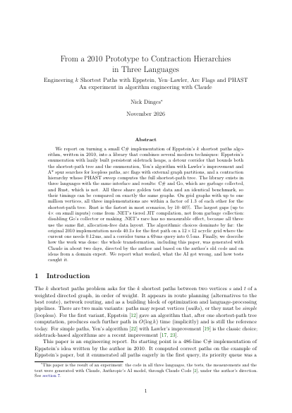

# k-shortest-path

Find the **shortest route** between two points in a network, then the **second shortest**, the
**third shortest**, and so on. This is a C# implementation (with Go and Rust ports) of
[Eppstein's algorithm](http://www.ics.uci.edu/~eppstein/pubs/Epp-SJC-98.pdf) for the
*k shortest paths* problem.

<a href="paper/main.pdf"></a>

### 📄 The paper

**[From a 2010 Prototype to Contraction Hierarchies in Three Languages](paper/main.pdf)**: how this
library grew from a 2010 prototype into Eppstein + Yen–Lawler + arc flags + contraction hierarchies,
in C#, Go and Rust. An experiment: code, tests, measurements and text were generated with Claude.

- Same graphs, three languages: within **1.6×** of each other in steady state; garbage collection
  costs **a few percent of the time**, but 1.6–1.8× the memory.
- Algorithms beat languages: first path **40 s → 0.12 ms** compared with the 2010 version.

[Read the PDF](paper/main.pdf) · [Summary](#the-paper) · [Reproduce](paper/README.md)

<br clear="right">


*The example graph from Eppstein's paper. The three shortest routes from S to T are drawn in red,
blue and green. The number under each letter is the distance from that point to T.*

> **Go and Rust versions:** ports with the same API and results live in [`go/`](go/README.md) and
> [`rust/`](rust/README.md).

**Contents:** [What it solves](#what-problem-does-this-solve) · [Quick start](#quick-start) ·
[First program](#your-first-program) · [What the library can do](#what-the-library-can-do) ·
[Documentation](#documentation) · [The paper](#the-paper)

---

## What problem does this solve?

A route planner usually shows you *one* best route. Often you also want **alternatives**: the
second-best route in case of a traffic jam, the third-best, and so on. Asking for the *k* best
routes is called the **k shortest paths problem**.

Typical uses:

- **Navigation:** show alternative routes.
- **Network routing:** have backup routes ready when a link fails.
- **Planning and scheduling:** list the cheapest few options, not only the cheapest one.
- **Bioinformatics and language processing:** rank the most likely candidates.

Eppstein's algorithm does this very efficiently. It does one main computation up front, and after
that each additional route comes out almost immediately.

## Quick start

**You need:** the [.NET 10 SDK](https://dotnet.microsoft.com/download/dotnet/10.0). It runs on
Linux, macOS and Windows. Check that it is installed:

```sh
dotnet --version     # should print 10.x.x or newer
```

The library itself runs on .NET 8 and .NET 10. The tests run on both, so `dotnet test` also needs
the [.NET 8 runtime](https://dotnet.microsoft.com/download/dotnet/8.0).

**Get the code and run the demo:**

```sh
git clone https://github.com/nickdinges/k-shortest-path.git
cd k-shortest-path
dotnet run --project csharp/Eppstein.Demo          # prints the 20 shortest paths of the example graph
dotnet run --project csharp/Eppstein.Demo -- 5     # prints only the 5 shortest paths
```

The output looks like this (each line is a route, with its total length in brackets):

```text
EPPSTEIN ALGORITHM TEST
Calculation time: 7 ms
S,D,E,F,J,T (55)
S,A,B,C,G,T (58)
S,A,B,F,J,T (59)
...
```

**Run the tests** (optional, checks that everything works):

```sh
dotnet test csharp/Eppstein.sln
```

## Your first program

Imagine five places connected by one-way roads. Each road is labeled with the number of minutes it
takes. We want the fastest ways from `HOME` to `OFFICE`.


**Step 1:** create your own console app and connect it to this library (run these commands next to
the `k-shortest-path` folder):

```sh
dotnet new console -o MyRoutes
dotnet add MyRoutes reference k-shortest-path/csharp/Eppstein/Eppstein.csproj
```

**Step 2:** replace the content of `MyRoutes/Program.cs` with:

```csharp
using System;
using Eppstein;

class Example
{
    static void Main()
    {
        Graph g = new Graph();

        // 1. Create the places (vertices)
        g.CreateVertices("HOME,PARK,BAKERY,STATION,OFFICE");

        // 2. Create one-way roads (edges): from, to, minutes, group name
        g.CreateEdges("HOME",   "PARK",    2, "walk");
        g.CreateEdges("HOME",   "BAKERY",  4, "walk");
        g.CreateEdges("PARK",   "BAKERY",  1, "walk");
        g.CreateEdges("PARK",   "STATION", 7, "walk");
        g.CreateEdges("BAKERY", "STATION", 2, "walk");
        g.CreateEdges("BAKERY", "OFFICE",  6, "walk");
        g.CreateEdges("STATION","OFFICE",  1, "train");

        // 3. Ask for the shortest route, then for the next ones
        GraphPath p = g.FindShortestPath("HOME", "OFFICE");
        for (int i = 1; i <= 5 && p.IsValid; i++)
        {
            Console.WriteLine(i + ". " + p.VertexNames + "  (" + p.Weight + " minutes)");
            p = g.FindNextShortestPath();
        }
    }
}
```

**Step 3:** run it:

```sh
dotnet run --project MyRoutes
```

```text
1. HOME,PARK,BAKERY,STATION,OFFICE  (6 minutes)
2. HOME,BAKERY,STATION,OFFICE  (7 minutes)
3. HOME,PARK,BAKERY,OFFICE  (9 minutes)
4. HOME,BAKERY,OFFICE  (10 minutes)
5. HOME,PARK,STATION,OFFICE  (10 minutes)
```

That's it. The pattern is always the same:

1. `CreateVertices` once,
2. `CreateEdges` for every connection,
3. `FindShortestPath` for the best route,
4. `FindNextShortestPath` repeatedly for the next ones.

> **Shorter with `foreach`:** `EnumeratePaths` gives you the paths one after the other, so steps 3
> and 4 become one loop. `Take(5)` (from `System.Linq`) stops after 5 paths:
>
> ```csharp
> foreach (GraphPath path in g.EnumeratePaths("HOME", "OFFICE").Take(5))
>     Console.WriteLine(path);   // e.g. "HOME,PARK,BAKERY,STATION,OFFICE (6)"
> ```

> **Tip:** `CreateEdges` can create several edges in one call. The lists are paired by position, so
> `g.CreateEdges("A,B", "C,D", 5, "x")` creates `A→C` and `B→D`, both with weight 5.

## What the library can do

| Feature | In one sentence | Details |
|---|---|---|
| **k shortest paths** | The best route, the second best, and so on; each further route comes out almost immediately (Eppstein's algorithm). | [User guide](docs/guide.md) |
| **Routes without loops** | `SimplePathsOnly` returns only paths that visit no place twice (Yen's algorithm with Lawler's improvement and A*). | [Routes without loops](docs/simple-paths.md) |
| **Corridor** | `MaxDetour` and `MaxDetourRatio` limit how much longer than the best route a path may be; this makes queries between nearby places fast on large graphs. | [Faster queries](docs/faster-queries.md) |
| **Arc flags and contraction hierarchy** | Optional preparation that makes later queries faster, with identical results. | [Faster queries](docs/faster-queries.md) |
| **Import and output** | CSV and DIMACS import, Graphviz (DOT) output for drawings. | [User guide](docs/guide.md#api-reference) |
| **Three languages** | The same interface and the same results in C# ([`csharp/`](csharp/)), Go ([`go/`](go/README.md)) and Rust ([`rust/`](rust/README.md)), checked against shared test data. | [Project layout and tests](docs/development.md) |

## Documentation

| Document | Content |
|---|---|
| [User guide](docs/guide.md) | Key ideas in plain words, the complete API reference, drawing graphs, common pitfalls |
| [Routes without loops](docs/simple-paths.md) | When and how to use `SimplePathsOnly`, and what it costs |
| [Faster queries](docs/faster-queries.md) | Corridor, arc flags (with external partitions) and contraction hierarchy |
| [How the algorithm works](docs/how-it-works.md) | The algorithms in plain words, and further reading |
| [Performance](docs/performance.md) | Measurements and how to run the benchmark |
| [Project layout and tests](docs/development.md) | Folders, tests, continuous integration |
| [Upgrading from version 1](docs/upgrading-from-v1.md) | What changed in the interface |
| [Go version](go/README.md), [Rust version](rust/README.md) | The ports and their specifics |
| [The paper](paper/main.pdf) | Algorithms with running times, the C#/Go/Rust comparison, and how the library was developed |
| [Suggestions](suggestions.md) | Ideas for further work |

## The paper

[`paper/main.pdf`](paper/main.pdf) (21 pages, English, LaTeX source in [`paper/`](paper/README.md)):
*From a 2010 Prototype to Contraction Hierarchies in Three Languages: Engineering k Shortest Paths
with Eppstein, Yen–Lawler, Arc Flags and PHAST*.

The paper is the result of an experiment: the code in all three languages, the tests, the
measurements and the text were generated with Claude (Anthropic) through Claude Code, under the
direction of the repository's author. It covers:

- **The algorithms, explained from the definitions onward** ([Faster queries](docs/faster-queries.md) and [How the algorithm works](docs/how-it-works.md) in
  more depth), so the paper can be read without the original articles: Dijkstra and the
  shortest-path tree, Eppstein's sidetracks and persistent heaps with a worked example, the
  detour bound (corridor), Yen–Lawler with exact A\*, arc flags, and contraction hierarchies with
  PHAST. Every algorithm comes with its running time and memory in O-notation, collected in one
  table, followed by related work.
- **C#, Go and Rust compared** on exactly the same graphs, with the same benchmark program in all
  three languages:
  - in steady state the three are within a factor of 1.6 for every shortest-path tree that takes
    at least a millisecond, and no language is fastest everywhere;
  - measured on the second query of a process, the gap is up to 5 times: that is .NET's tiered
    JIT compilation on short runs, not garbage collection;
  - garbage collection costs a few percent of the time (.NET pauses for about 4% while 100,000
    paths are enumerated; Go with the collector switched off is not faster), but the
    garbage-collected processes need 1.6 to 1.8 times the peak memory of the Rust process;
  - 95–99% of the time for enumerating paths is writing the paths out, not finding them.
- **Algorithms matter more than languages:** the original 2010 version needs 40 s for the first path
  on a 12×12 grid, the current one 0.12 ms; a corridor turns a 75 ms query into 0.5 ms.
- **How the work was done:** what came from the author (the 2010 code, short requests, ideas from
  a domain expert), what Claude did, where it made mistakes, and how the tests caught them. A
  critical review of the first version of the paper found errors that no test could catch (a
  wrong citation, claims without data, a result distorted by JIT warm-up); they are listed too.
- **Threats to validity:** all experiments use synthetic grids, not road networks; there is one
  implementation per language; differences below about 30% are within the measurement noise.

Every number in the paper comes from scripts and CSV files in `paper/`; see
[`paper/README.md`](paper/README.md) to reproduce the measurements and to build the PDF.

## License

[MIT](LICENSE)
