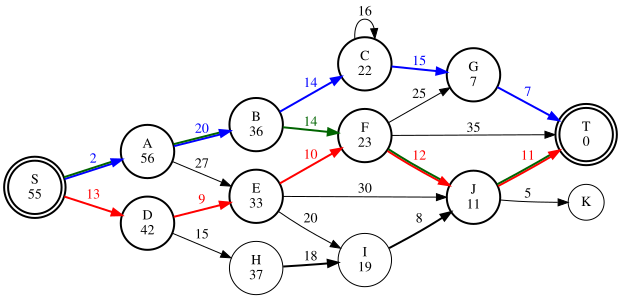
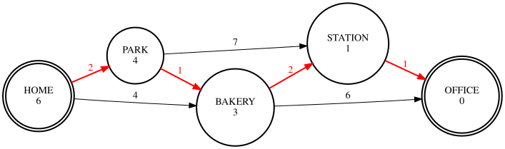

# k-shortest-path

Find the **shortest route** between two points in a network, then the **second shortest**, the
**third shortest**, and so on. This is a C# implementation of
[Eppstein's algorithm](http://www.ics.uci.edu/~eppstein/pubs/Epp-SJC-98.pdf) for the
*k shortest paths* problem.



*The example graph from Eppstein's paper. The three shortest routes from S to T are drawn in red,
blue and green. The number under each letter is the distance from that point to T.*

> **Go version:** a Go port with the same API lives in [`go/`](go/README.md).

**Contents**

1. [What problem does this solve?](#1-what-problem-does-this-solve)
2. [Quick start](#2-quick-start)
3. [Your first program](#3-your-first-program)
4. [Key ideas in plain words](#4-key-ideas-in-plain-words)
5. [API reference](#5-api-reference)
6. [Drawing your graph (Graphviz)](#6-drawing-your-graph-graphviz)
7. [Things to know (common pitfalls)](#7-things-to-know-common-pitfalls)
8. [Faster queries: corridor and arc flags](#8-faster-queries-corridor-and-arc-flags)
9. [How the algorithm works](#9-how-the-algorithm-works)
10. [Performance](#10-performance)
11. [Project layout and tests](#11-project-layout-and-tests)
12. [Upgrading from version 1](#12-upgrading-from-version-1)
13. [Further reading](#13-further-reading)

---

## 1. What problem does this solve?

A route planner usually shows you *one* best route. Often you also want **alternatives**: the
second-best route in case of a traffic jam, the third-best, and so on. Asking for the *k* best
routes is called the **k shortest paths problem**.

Typical uses:

- **Navigation:** show alternative routes.
- **Network routing:** have backup routes ready when a link fails.
- **Planning and scheduling:** list the cheapest few options, not only the cheapest one.
- **Bioinformatics and language processing:** rank the most likely candidates.

Eppstein's algorithm does this very efficiently. It does one main computation up front, and after
that each additional route comes out almost immediately.

## 2. Quick start

**You need:** the [.NET 8 SDK](https://dotnet.microsoft.com/download/dotnet/8.0). It runs on
Linux, macOS and Windows. Check that it is installed:

```sh
dotnet --version     # should print 8.x.x or newer
```

**Get the code and run the demo:**

```sh
git clone https://github.com/nickdinges/k-shortest-path.git
cd k-shortest-path
dotnet run --project Eppstein.Demo          # prints the 20 shortest paths of the example graph
dotnet run --project Eppstein.Demo -- 5     # prints only the 5 shortest paths
```

The output looks like this (each line is a route, with its total length in brackets):

```text
EPPSTEIN ALGORITHM TEST
Calculation time: 7 ms
S,D,E,F,J,T (55)
S,A,B,C,G,T (58)
S,A,B,F,J,T (59)
...
```

**Run the tests** (optional, checks that everything works):

```sh
dotnet test Eppstein.sln
```

## 3. Your first program

Imagine five places connected by one-way roads. Each road is labeled with the number of minutes it
takes. We want the fastest ways from `HOME` to `OFFICE`.



**Step 1:** create your own console app and connect it to this library (run these commands next to
the `k-shortest-path` folder):

```sh
dotnet new console -o MyRoutes
dotnet add MyRoutes reference k-shortest-path/Eppstein/Eppstein.csproj
```

**Step 2:** replace the content of `MyRoutes/Program.cs` with:

```csharp
using System;
using Eppstein;

class Example
{
    static void Main()
    {
        Graph g = new Graph();

        // 1. Create the places (vertices)
        g.CreateVertices("HOME,PARK,BAKERY,STATION,OFFICE");

        // 2. Create one-way roads (edges): from, to, minutes, group name
        g.CreateEdges("HOME",   "PARK",    2, "walk");
        g.CreateEdges("HOME",   "BAKERY",  4, "walk");
        g.CreateEdges("PARK",   "BAKERY",  1, "walk");
        g.CreateEdges("PARK",   "STATION", 7, "walk");
        g.CreateEdges("BAKERY", "STATION", 2, "walk");
        g.CreateEdges("BAKERY", "OFFICE",  6, "walk");
        g.CreateEdges("STATION","OFFICE",  1, "train");

        // 3. Ask for the shortest route, then for the next ones
        GraphPath p = g.FindShortestPath("HOME", "OFFICE");
        for (int i = 1; i <= 5 && p.IsValid; i++)
        {
            Console.WriteLine(i + ". " + p.VertexNames + "  (" + p.Weight + " minutes)");
            p = g.FindNextShortestPath();
        }
    }
}
```

**Step 3:** run it:

```sh
dotnet run --project MyRoutes
```

```text
1. HOME,PARK,BAKERY,STATION,OFFICE  (6 minutes)
2. HOME,BAKERY,STATION,OFFICE  (7 minutes)
3. HOME,PARK,BAKERY,OFFICE  (9 minutes)
4. HOME,BAKERY,OFFICE  (10 minutes)
5. HOME,PARK,STATION,OFFICE  (10 minutes)
```

That's it. The pattern is always the same:

1. `CreateVertices` once,
2. `CreateEdges` for every connection,
3. `FindShortestPath` for the best route,
4. `FindNextShortestPath` repeatedly for the next ones.

> **Shorter with `foreach`:** `EnumeratePaths` gives you the paths one after the other, so steps 3
> and 4 become one loop. `Take(5)` (from `System.Linq`) stops after 5 paths:
>
> ```csharp
> foreach (GraphPath path in g.EnumeratePaths("HOME", "OFFICE").Take(5))
>     Console.WriteLine(path);   // e.g. "HOME,PARK,BAKERY,STATION,OFFICE (6)"
> ```

> **Tip:** `CreateEdges` can create several edges in one call. The lists are paired by position, so
> `g.CreateEdges("A,B", "C,D", 5, "x")` creates `A→C` and `B→D`, both with weight 5.

## 4. Key ideas in plain words

| Term | Meaning | In this library |
|---|---|---|
| **Graph** | A network of points and connections. | `Graph` |
| **Vertex** (node) | A point in the network: a city, a router, a state. | `Vertex`, created by name with `CreateVertices` or `AddVertex` |
| **Edge** (arc) | A **one-way** connection from one vertex to another. For a two-way road, create two edges. | `Edge`, created with `CreateEdges` or `AddEdge` |
| **Weight** | The cost of using an edge: distance, time, price… Whole numbers of type `long` (up to about 9.2 × 10¹⁸). | `Edge.Weight` |
| **Group** | A name you give to edges, so you can change all their weights at once. | `EdgeGroupWeights` |
| **Path** (route) | A chain of edges from the start to the goal. | `GraphPath` |
| **Path weight** | The sum of all edge weights in the path. "Shortest" means "smallest total weight". | `GraphPath.Weight` |
| **k shortest paths** | The best path, the 2nd best, …, the k-th best. | `FindShortestPath` + `FindNextShortestPath` |

## 5. API reference

All methods are on the `Graph` class (namespace `Eppstein`).

### Building the graph

| Method | What it does | Returns |
|---|---|---|
| `CreateVertices("A,B,C")` | Creates the vertices. **Replaces** all existing vertices *and edges*. | `true`, or `false` if a name is invalid |
| `CreateEdges(from, to, weight, group)` | Adds one-way edges. `from` and `to` are comma-separated lists of the same length. | `true`, or `false` if a vertex doesn't exist or the lists differ in length |
| `EdgeGroupWeights(group, weight)` | Sets a new weight for every edge of a group. | nothing |

For **large graphs**, add vertices and edges by number instead of by name. This is several times
faster, because no name lists have to be split and looked up for every edge:

| Method | What it does | Returns |
|---|---|---|
| `AddVertex("A")` | Adds one vertex and keeps everything else. | its **index** (0, 1, 2, …); the existing index if the name is taken; `-1` if the name is invalid |
| `AddEdge(fromIndex, toIndex, weight)` | Adds one one-way edge between vertices given by index. An overload takes a `group` as 4th value. | the **edge number** (0, 1, 2, …), or `-1` if an index is invalid |
| `GetVertexIndex("A")` | Index of a vertex. | the index, or `-1` |
| `VertexCount`, `EdgeCount` | Number of vertices and edges (valid indices are `0` to `VertexCount - 1`). | |
| `SetEdgeWeight(edge, weight)` | Changes the weight of one edge (an `Edge` or its number). | nothing |
| `ImportEdges(reader)` | Reads edges from a CSV text (see below). | number of edges read |
| `ImportDimacs(reader)` | Reads a graph in the DIMACS format (see below). | number of edges read |

```csharp
Graph g = new Graph();
int home = g.AddVertex("HOME");
int office = g.AddVertex("OFFICE");
g.AddEdge(home, office, 10);
GraphPath p = g.FindShortestPath(home, office);   // also works with indices
```

All ways of building can be mixed. Vertices created by `CreateVertices` get indices too, in the
order of the list.

**CSV files** (`ImportEdges`): one edge per line, `from,to,weight` or `from,to,weight,group`.
Missing vertices are created. Empty lines and lines starting with `#` are skipped:

```text
# from,to,weight,group
HOME,PARK,2
PARK,OFFICE,7,train
```

```csharp
using (var file = new System.IO.StreamReader("roads.csv"))
    g.ImportEdges(file);
```

**DIMACS files** (`ImportDimacs`): the format of the
[DIMACS road networks](https://www.diag.uniroma1.it/challenge9/download.shtml) with millions of
vertices. Vertex number `n` gets the name `V` + `n` (`V1`, `V2`, …):

```text
c comment
p sp 3 2        <- 3 vertices, 2 edges
a 1 2 5         <- edge from vertex 1 to vertex 2, weight 5
a 2 3 5
```

Both imports keep what is already in the graph. A broken line throws a `FormatException` whose
message starts with the line number (`Line 7: invalid weight 'x'`); the lines before it stay
imported.

### Asking for paths

| Method | What it does | Returns |
|---|---|---|
| `FindShortestPath(start, goal)` | Prepares everything and returns the **shortest** path. Start and goal are names, or indices (see above). | `GraphPath` (empty if none exists) |
| `FindNextShortestPath()` | Returns the **next** shortest path. Call it again and again. | `GraphPath` (empty when there are no more) |
| `EnumeratePaths(start, goal)` | All paths in order, for `foreach` and LINQ (`.Take(10)`). | `IEnumerable<GraphPath>` |
| `EnumeratePathWeights(start, goal)` | Only the weights of the paths, in order. Faster, because the paths are not built. | `IEnumerable<long>` |

### Working with a `GraphPath`

A `GraphPath` is a read-only list of `Edge` values, so you can loop over it with `foreach`. It
never changes after it was returned.

| Member | Meaning |
|---|---|
| `IsValid` | `true` if the path contains at least one edge. Use it to check for "no path". |
| `Weight` | Total weight (sum of all edges, at the time the path was found). |
| `VertexNames` | The route as text, e.g. `"HOME,PARK,OFFICE"`. |
| `Vertices` | The vertices of the route, in order. |
| `Count`, `path[i]` | Number of edges, and the edge at a position. |

### Vertices and edges

`Vertex` and `Edge` are small read-only values that refer to the graph. Two values are equal
(`==`) if they refer to the same vertex or edge.

| Member | Meaning |
|---|---|
| `g.FindVertex("A")` | The vertex with a name, or `null`. |
| `g.GetVertex(index)`, `g.GetEdge(number)` | The vertex or edge with an index or number. |
| `g.Vertices`, `g.Edges` | All vertices or edges. |
| `vertex.Label`, `vertex.Index` | Name and index. |
| `vertex.OutEdges`, `vertex.InEdges` | The edges leaving or arriving at the vertex. |
| `vertex.Tag` | Any object of your own, attached to the vertex (e.g. coordinates). |
| `vertex.Distance`, `vertex.Next` | After a query: distance to the goal, and the next vertex on the shortest way there. |
| `edge.Tail`, `edge.Head`, `edge.Weight`, `edge.Group` | Start vertex, end vertex, weight and group. |

Changes always go through the graph (`SetEdgeWeight`, `EdgeGroupWeights`), never through a vertex
or edge. That way the graph always knows when its prepared data is outdated.

### Extras

| Method | What it does | Section |
|---|---|---|
| `Serialize(...)` | Produces a Graphviz drawing of the graph. | [6](#6-drawing-your-graph-graphviz) |
| `MaxDetour`, `MaxDetourRatio` | Only paths at most this much longer than the shortest one (much faster on large graphs). | [8](#8-faster-queries-corridor-and-arc-flags) |
| `EnableArcFlags(...)`, `DisableArcFlags()`, `PrecomputeArcFlags()`, `ArcFlagsEnabled`, `ArcFlagsRegionCount` | Optional speed-up for many queries. | [8](#8-faster-queries-corridor-and-arc-flags) |

## 6. Drawing your graph (Graphviz)

`Serialize` turns your graph into text in the
[DOT language](https://graphviz.org/doc/info/lang.html). The free tool
[Graphviz](https://graphviz.org/download/) turns that text into a picture. All pictures in this
README were made this way.

```csharp
string dot = g.Serialize();                    // just the graph
dot = g.Serialize(path);                       // with one path highlighted in red
dot = g.Serialize(new List<GraphPath> { p1, p2 });  // several paths, one color each
System.IO.File.WriteAllText("graph.dot", dot); // save it to a file
```

Then create an image from the command line:

```sh
dot -Tsvg graph.dot -o graph.svg    # or -Tpng graph.png
```

No Graphviz installed? Paste the text into an online viewer such as
[GraphvizOnline](https://dreampuf.github.io/GraphvizOnline/).

The demo program can do this for you. This draws the example graph with its 3 shortest paths:

```sh
dotnet run --project Eppstein.Demo -- 5 --dot graph.dot
```

**How to read the picture:**

- The numbers on the arrows are the edge weights.
- Highlighted paths are colored (red, blue, green, …). If several paths share an edge, it is drawn
  in all their colors.
- After `FindShortestPath`:
  - the start and goal are drawn as **double circles**,
  - the number under each name is the **distance to the goal**,
  - **bold** arrows are the shortest-path tree (from every vertex, the best next step towards the
    goal).
- **Dashed** arrows have a negative weight, so they are switched off (see section 7).
- If arc flags are on, each region is drawn as a dashed box (see section 8).
- With a corridor (section 8), vertices outside of it show no distance: they were not needed.

## 7. Things to know (common pitfalls)

**1. Graphs with loops produce endless paths.** Paths may visit the same vertex more than once.
For example, the demo graph has a loop `C→C`, so `S,A,B,C,C,G,T` and `S,A,B,C,C,C,G,T` are also
valid paths. If your graph has any cycle, there are infinitely many paths. **Always limit the
number of paths you ask for:**

```csharp
for (int i = 0; i < 10 && p.IsValid; i++) { ... }   // good: at most 10 paths
while (p.IsValid) { ... }                            // may never end on a graph with cycles
```

Alternatively, set a corridor (`MaxDetour` or `MaxDetourRatio`, section 8): then the number of
paths is finite and the `while` loop ends by itself.

**2. An empty path means "no path".** `FindShortestPath` returns an empty path
(`IsValid == false`) when:

- a vertex name doesn't exist, or
- the goal can't be reached from the start, or
- start and goal are the same vertex.

**3. Vertex names:** letters and digits only, starting with a letter (`A1` is fine; `1A`, `A-B`,
`A B` are not). Names are **not case-sensitive** and are stored in upper case (`home` becomes
`HOME`).

**4. Negative weights switch edges off.** Edges with a weight below 0 are ignored completely.
This is handy for "closing" a group of roads temporarily:

```csharp
g.EdgeGroupWeights("train", -1);   // ignore all train connections
g.EdgeGroupWeights("train", 1);    // turn them back on
```

**5. Changing the graph means asking again.** After `CreateEdges`, `SetEdgeWeight` or
`EdgeGroupWeights`, call `FindShortestPath` again. Until then, `FindNextShortestPath` returns empty
paths. A running `EnumeratePaths` loop stops with an `InvalidOperationException` if the graph
changes or another query starts, because its paths would no longer be correct. The graph keeps
**one query at a time**.

**6. Equal weights come in no guaranteed order.** If two paths have the same total weight, either
one may come first. The order is the same every time you run the same program, but it may differ
between versions of the library (and between the C# and the Go version).

**7. Paths are `GraphPath`, not `Path`.** In older versions the class was called `Path`. That
clashed with .NET's own `System.IO.Path` (for file paths), which new projects import
automatically, and caused the error *"'Path' is an ambiguous reference"*. If you upgrade, see
[Upgrading from version 1](#12-upgrading-from-version-1).

**8. Weights are `long`, not `int`.** Weights and distances are 64-bit numbers, so very large
weights (for example distances in millimeters) work. Passing an `int` is fine
(`CreateEdges("A", "B", 5, "x")`), but reading a weight into an `int` variable does not compile:

```csharp
long w = path.Weight;   // or: var w = path.Weight;
int  x = path.Weight;   // error CS0266: cannot convert 'long' to 'int'
```

The total weight of a path must still fit into a `long`; there is no overflow check.

**9. How errors are reported.** Methods that create or look up something from your data report a
failure in their result: `false`, `-1` or `null` (for example `AddVertex("1A")` returns `-1`,
because names must start with a letter). Mistakes in the program itself throw an exception:
`null` arguments, an index out of range, a negative limit. Broken import files throw a
`FormatException` with the line number.

**10. One graph, one thread.** A graph is not thread-safe. Use a separate graph per thread.

## 8. Faster queries: corridor and arc flags

Both are optional. The results never change, except that the corridor deliberately leaves out
paths that are too long.

### Corridor: only paths that are not much longer

In practice you rarely want *every* alternative: a route that is three times as long as the best
one is useless. Tell the library how much longer a path may be, and it only looks at the part of
the graph where such paths can lie:

```csharp
g.MaxDetourRatio = 0.2;   // paths at most 20% longer than the shortest one
// or an absolute limit, in the unit of your weights:
g.MaxDetour = 15;         // paths at most 15 minutes longer than the shortest one

foreach (GraphPath p in g.EnumeratePaths("HOME", "OFFICE"))   // ends by itself: finitely many paths
    Console.WriteLine(p);
```

Good to know:

- **Big speed-up on large graphs**, when start and goal are close to each other: the search only
  covers the area around the goal that is reachable within "shortest + detour". In a network
  with 1 million vertices, a repeated local query takes 3 ms instead of 78 ms (see section 10).
- The number of paths within the limit is finite, so a loop over `EnumeratePaths` (or
  `while (p.IsValid)` with `FindNextShortestPath`) ends by itself, even with cycles.
- If you set both, the **smaller** limit applies.
- After changing a limit, call `FindShortestPath` again.
- Remove the limits with `g.MaxDetour = long.MaxValue;` and
  `g.MaxDetourRatio = double.PositiveInfinity;` (the defaults).

### Arc flags: preparation for many queries

*Rarely needed. Try the corridor first.*

> **Honest note:** Eppstein's algorithm needs the distance of *every* reachable vertex to the
> goal, so arc flags cannot skip vertices, only some edge checks. In our measurements queries
> became at most slightly faster, while the preparation takes about 1 s for 40,000 vertices.
> The corridor above is the much bigger lever. Arc flags stay available for graphs where many
> edges are never part of a shortest path.

**The idea in one sentence:** split the vertices into regions, and remember for every edge whether
it is ever useful for reaching each region. When you later search for routes into a region, edges
that are never useful for it are skipped.

Think of road signs: a small side street is never part of the fastest route to the airport, so a
search towards the airport can ignore it.

```csharp
g.EnableArcFlags(3);   // let the library split the graph into about 3 regions
// or choose regions yourself (separated by ';'), unlisted vertices form one extra region:
g.EnableArcFlags("S,A,B,C;D,E,F;G,H,I,J,K,T");

GraphPath p = g.FindShortestPath("S", "T");   // same results as before, possibly faster
```

Good to know:

- **Results are exactly the same** as without arc flags. Only the work behind the scenes changes.
- The preparation happens automatically on the next query, or right away with
  `g.PrecomputeArcFlags()`.
- Changing edges or weights is fine; the flags are recomputed automatically.
- `CreateVertices` turns arc flags off. Call `EnableArcFlags` again afterwards.
- The preparation costs time. It pays off only if you run **many** queries on the same graph.
- `g.DisableArcFlags()` switches the feature off again.

<details>
<summary>Technical details</summary>

Every arc `(u,v)` gets one flag per region `r`. The flag is set if the arc lies on a shortest path
from `u` to some vertex of `r`. To compute the flags, one backward Dijkstra runs from each boundary
vertex of each region. A query then only relaxes arcs flagged for the region of the goal `t`.
Every shortest path `u → t` uses only such arcs, so all distances stay exact.

</details>

## 9. How the algorithm works

You don't need this to use the library, but here's the intuition.

1. **Distances to the goal.** One run of
   [Dijkstra's algorithm](https://en.wikipedia.org/wiki/Dijkstra%27s_algorithm), backwards from
   the goal, finds for every vertex its shortest distance to the goal and the best next step. These
   best steps form the **shortest-path tree** (the bold arrows in the drawings).
2. **Detours ("sidetracks").** Any other edge is a detour. Taking edge `u→v` instead of `u`'s best
   step costs extra:

   `extra = weight(u→v) + distance(v) − distance(u)`

   This is never negative.
3. **Every path = a list of detours.** Follow the tree, except where you take a detour. So a path
   is fully described by its detours, and its length is the shortest length plus the extra costs.
4. **Detours sorted per vertex.** For every vertex `v`, a heap (a structure that always knows its
   smallest element) holds all detours you can still take on the way from `v` to the goal, sorted
   by their extra cost. The heap of `v` is the heap of the next vertex plus `v`'s own detours.
   It is *persistent*: building it copies only a few nodes and shares the rest, so it is cheap.
   Heaps are only built for vertices that are actually needed.
5. **Best first.** A priority queue (a "to-do list" sorted by total length) starts with the
   shortest path (no detours). Each time a path is taken out, at most three new candidates are
   added: the *next best alternatives* for its last detour (two heap neighbors), and the *best
   additional detour* after it (top of the heap at its end). Extra costs are never negative, so
   paths come out in the right order. Only what is needed is computed, which is why graphs with
   cycles work. This is the core idea of Eppstein's paper.

## 10. Performance

The library handles graphs with millions of edges. Measured on grid graphs (each vertex connected
to its right and lower neighbor, every 10th vertex also back to the left, random weights 1–100),
in Release mode on a 4-core cloud VM.

**From one corner to the opposite one** (paths cross the whole graph; built by index):

| Vertices | Edges | Build graph | Memory | First path | First path, repeated query | Next 10,000 paths |
|---|---|---|---|---|---|---|
| 2,500 | 5,100 | 7 ms | < 1 MB | 9 ms | 4 ms | 46 ms |
| 10,000 | 20,700 | 8 ms | 2 MB | 10 ms | 9 ms | 59 ms |
| 40,000 | 83,400 | 14 ms | 7 MB | 38 ms | 33 ms | 70 ms |
| 160,000 | 334,800 | 44 ms | 26 MB | 52 ms | 37 ms | 74 ms |
| 1,000,000 | 2,097,000 | 285 ms | 117 MB | 376 ms | 320 ms | 324 ms |

**Building the graph** with 1,000,000 vertices and 2,097,000 edges (section 5):

| Way of building | Time |
|---|---|
| `CreateVertices` + `CreateEdges` (by name) | 1.2 s |
| `AddVertex` + `AddEdge` (by index) | **0.29 s** |
| `ImportDimacs` (from text in memory) | 0.7 s |

**Between two nearby vertices** in the middle of the 1,000,000-vertex grid, with and without a
corridor (section 8):

| Corridor | First path | First path, repeated query | Next paths | Paths found |
|---|---|---|---|---|
| none | 273 ms | 78 ms | 32 ms | 10,000 (limit of the benchmark) |
| `MaxDetourRatio = 0.1` | 87 ms | **3 ms** | 35 ms | 10,000 (limit of the benchmark) |
| `MaxDetourRatio = 0.02` | 82 ms | **4 ms** | 4 ms | 1,169 (all within 2%) |

The first query after building or changing the graph includes one-time preparation (sorting the
edges by direction); the "repeated query" column shows a query without it.

What makes it fast:

- **Compact storage:** vertices and edges live in plain arrays: 117 MB for the graph with
  1,000,000 vertices and 2,097,000 edges (version 1 needed 476 MB). That also makes the searches
  more cache-friendly. `Vertex`,
  `Edge` and the edges of a `GraphPath` are small values pointing into these arrays.
- **No cleanup between queries:** each query has a number, and a distance only counts if it was
  computed by the current query. So a query only touches the vertices it reaches.
- **Vertex lookup by name** uses a dictionary; building by index (`AddVertex`/`AddEdge`) skips the
  name lookup completely.
- **Priority queues** are binary heaps (O(log n) per operation).
- **At most three candidates per path**, thanks to the persistent detour heaps (section 9).
  Candidates store only their parent and one detour, not a copy of all detours.
- **The corridor** stops the shortest-path search where no allowed path can lie.
- **Edges are stored by direction**, so the searches never look at edges going the wrong way.

Run the benchmark yourself (sizes are grid widths; `--k` = number of paths, `--local` = nearby
vertices, `--ratio` = `MaxDetourRatio`, `--build strings|index|dimacs` = way of building):

```sh
dotnet run -c Release --project Eppstein.Benchmarks -- 50 100 200 --k 10000
dotnet run -c Release --project Eppstein.Benchmarks -- 1000 --local --ratio 0.1
dotnet run -c Release --project Eppstein.Benchmarks -- 1000 --build index
```

## 11. Project layout and tests

| Folder / file | Content |
|---|---|
| `Eppstein/` | The library (NuGet package `Eppstein.KShortestPaths`) |
| `Eppstein/Graph.cs` | Storage, building the graph, vertices and edges |
| `Eppstein/Graph.Paths.cs` | Queries: Dijkstra, corridor, path enumeration |
| `Eppstein/Graph.ArcFlags.cs` | Optional arc-flags speed-up |
| `Eppstein/Graph.Import.cs` | CSV and DIMACS import |
| `Eppstein/Graph.Serialize.cs` | Graphviz (DOT) output |
| `Eppstein/Vertex.cs`, `Edge.cs`, `GraphPath.cs` | The public value types |
| `Eppstein/SidetrackHeap.cs` | Persistent heap of detours (Eppstein's path enumeration) |
| `Eppstein.Demo/` | Demo program (`dotnet run --project Eppstein.Demo -- [k] [--dot file]`) |
| `Eppstein.Tests/` | Automated tests (xUnit) |
| `Eppstein.Benchmarks/` | Timing benchmark (see section 10) |
| `testdata/golden/` | Graphs with expected paths, checked by the C# **and** the Go tests |
| `.github/workflows/ci.yml` | CI: build, tests and a benchmark comparison for every pull request |
| `docs/` | Images used in this README |
| `go/` | Go port of the library ([own README](go/README.md)) |

```sh
dotnet build Eppstein.sln   # compile (warnings count as errors)
dotnet test Eppstein.sln    # run all tests
dotnet pack Eppstein/Eppstein.csproj -c Release -o artifacts   # build the NuGet package
```

The tests compare the results with a brute-force search on hundreds of random graphs (with and
without cycles, corridors and arc flags), and check the shared golden data, the Graphviz output
and the error handling. For every pull request, the CI also runs the benchmarks of the base
branch and of the pull request on the same machine and shows both in the job summary.

## 12. Upgrading from version 1

Version 2 changed the interface. What to change in your code:

| Version 1 | Version 2 |
|---|---|
| Project `Eppstein2` (a program) | Library `Eppstein` (NuGet `Eppstein.KShortestPaths`); demo in `Eppstein.Demo` |
| `Path` | `GraphPath` (read-only; `Weight` is stored) |
| `edge.Weight = 5;` | `g.SetEdgeWeight(edge, 5);` |
| `vertex.RelatedEdges` | `vertex.OutEdges` and `vertex.InEdges` |
| `vertex.Object` | `vertex.Tag` |
| `vertex.Distance = …`, `vertex.EdgeToPath`, `vertex.Region` set by hand | read-only: `Distance`, `TreeEdge`, `Region` |
| `int w = path.Weight;` | `long w = path.Weight;` |
| `bool ok = g.AddEdge(…)` | `int id = g.AddEdge(…)` (edge number, `-1` on error) |
| `g.AddVertex(null)` returned `-1` | throws `ArgumentNullException` |
| `vertex.Equals("A")` (vertex vs. string) | `vertex.Label == "A"` |
| `SP_Node`, `ST_Node`, `PriorityQueue<T>` | removed (internal details) |
| loop with `FindNextShortestPath` | still works; `EnumeratePaths` is shorter |

## 13. Further reading

- David Eppstein, *Finding the k Shortest Paths*, SIAM Journal on Computing, 1998:
  [paper (PDF)](http://www.ics.uci.edu/~eppstein/pubs/Epp-SJC-98.pdf).
  The algorithm finds the k shortest paths, allowing repeated vertices and edges. After one
  shortest-path computation it needs only constant time per path. It is widely cited in route
  planning, network routing, computational linguistics and bioinformatics.
- [K shortest path routing](https://en.wikipedia.org/wiki/K_shortest_path_routing) on Wikipedia,
  including variants that only allow paths without repeated vertices (Yen's algorithm).
- [Graphviz documentation](https://graphviz.org/documentation/).
